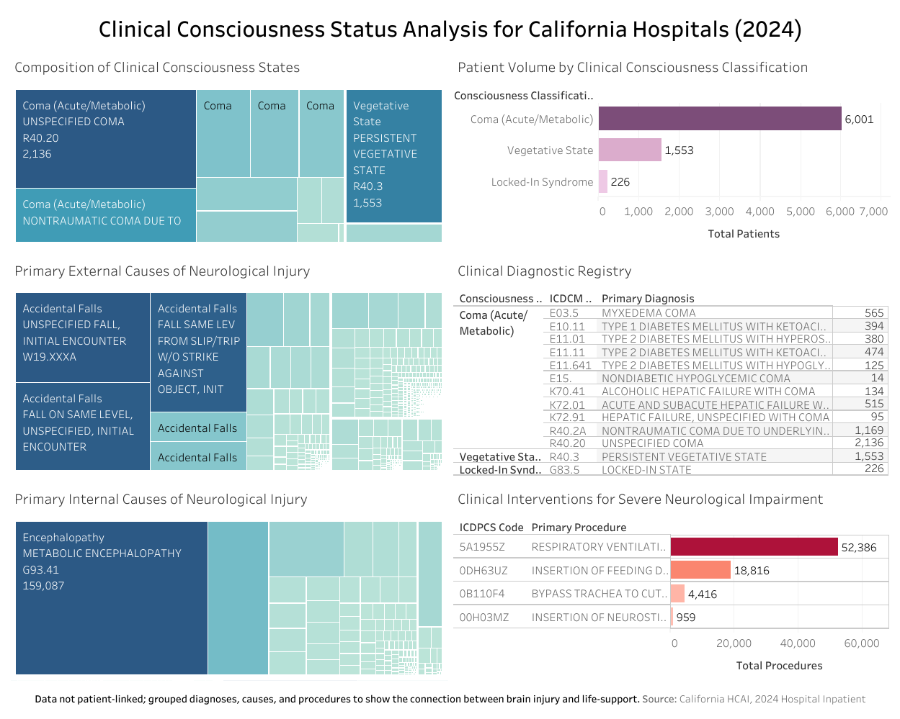

  <h1>🩺 Clinical Consciousness Status Analysis for California Hospitals (2024)</h1>

  

    An interactive dashboard analyzing neurological
    diagnoses and clinical interventions in California hospitals.
  

<h2>📑 Table of Contents</h2>

<ul>
  <li><a href="#objective">Objective</a></li>
  <li><a href="#project-details">Project Details</a></li>
  <li><a href="#dashboard">Dashboard</a></li>
  <li><a href="#images">Images</a></li>
</ul>

<h2 id="objective">🎯 Objective</h2>

  This project analyzes the prevalence of Coma,
  Vegetative State, and Locked-in Syndrome in California
  for 2024. Using California Department of Health Care
  Access and Information (HCAI) hospital inpatient data,
  the interactive Tableau Viz illustrates the relationship
  between Clinical Diagnoses, Causes, and Interventions
  required for patient care.

<h2 id="project-details">🛠️ Project Details</h2>

  <strong>Tools:</strong> Tableau, Microsoft Excel

<h2 id="dashboard">🌐 Dashboard</h2>

  <a href="https://public.tableau.com/views/ClinicalConsciousnessStatusAnalysisforCaliforniaHospitals2024/Dashboard1">
    View Dashboard
  </a>

<h2 id="images">🖼️ Images</h2>

<h3>Clinical Consciousness Status Analysis Dashboard</h3>

<table>
  <tr>
    <td>
      
    </td>
  </tr>
</table>

  

    <a href="https://github.com/redefiningvicky/Technical-Projects">
      Back to Technical Projects
    </a>
    &nbsp; • &nbsp;
    <a href="https://github.com/redefiningvicky/redefiningvicky">
      Back to Portfolio
    </a>
  

